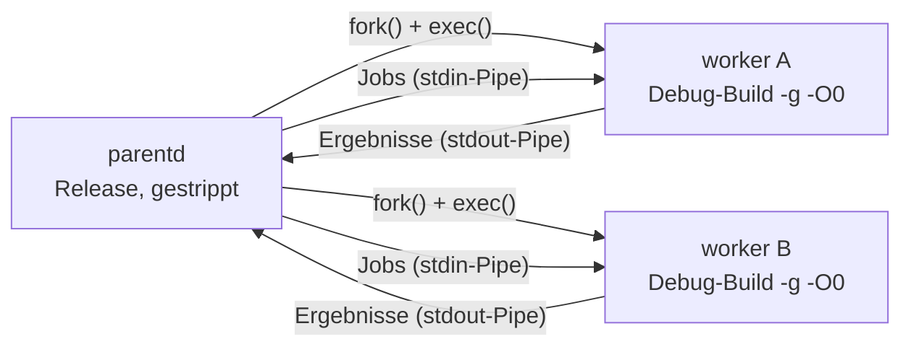

# Multi-Process-Debugging mit GDB

Anleitung für das knifflige Szenario: **Ein Parent-Prozess läuft im Release-Mode ohne Debug-Symbole, spawnt mehrere Kind-Prozesse, und genau die Kind-Prozesse sind der Code, den du debuggen willst.**

Das zugehörige Demo-Projekt (`multiproc-gdb-demo.tar.gz`, per Download-Karte verfügbar) baut genau diese Situation nach:

- `parentd`: Release-Build (`-O2 -DNDEBUG`, per `-Wl,-s` gestrippt). Spawnt per `fork()` + `execl()` zwei Worker und verteilt Jobs über Pipes.
- `worker`: Debug-Build (`-g -O0 -fno-omit-frame-pointer`). Das eigentliche Debug-Ziel, mit einem eingebauten Bug.
- Der Job `123456789` hat 9 Ziffern, `digit_sum()` reserviert aber nur 8 Plätze im Array → Stack-Buffer-Overflow. Deine Aufgabe: den Crash mit GDB in den Griff bekommen.



## Schritt 0: Bauen und verifizieren

```bash
tar xzf multiproc-gdb-demo.tar.gz
cd multiproc-gdb-demo
./scripts/build.sh
```

Das Skript baut beide Targets und prüft den Symbol-Status. Erwartete Ausgabe:

```text
--- parentd: 'file' zeigt 'stripped' ---
build/parentd: ELF 64-bit ... executable ... stripped
--- worker: 'file' zeigt 'with debug_info, not stripped' ---
build/worker: ELF 64-bit ... executable ... with debug_info, not stripped

--- nm build/parentd (erwartet: no symbols) ---
nm: build/parentd: no symbols

--- nm build/worker (Auszug) ---
00000000000012e9 T _Z9digit_suml
0000000000001139 T _Z10debug_gatev
```

Damit ist der Ist-Zustand bestätigt: Der Parent ist eine Black Box, der Worker voll instrumentiert.

Ohne Hilfsmittel sieht ein Lauf so aus (`./build/parentd 2` ohne Gate):

```text
[parent] 2 Worker gestartet (PIDs: 1234 1235)
OK 11 -> Quersumme 2
OK 42 -> Quersumme 6
...
[parent] Worker 1234: von Signal 6 beendet (Crash!)
[parent] Worker 1235: von Signal 6 beendet (Crash!)
[parent] fertig, 2 Crash(es)
```

## Warum das Szenario knifflig ist

1. **Der Parent hat keine Symbole.** Klassische Breakpoints nach Funktionsnamen sind dort unmöglich, Backtraces zeigen nur `??`. (Weniger schlimm als es klingt: `fork()` und `exec()` sind Kernel-Events, die GDB auch bei gestrippten Binaries sauber sieht.)
2. **Die Worker sind kurzlebig.** Bis du per `pgrep` eine PID gefunden und `gdb -p` gestartet hast, ist der Prozess oft schon lange tot. Man braucht einen Mechanismus, der die Worker am Leben hält.
3. **Attach ist möglicherweise verboten.** Moderne Distros (Ubuntu, Fedora, ...) setzen `kernel.yama.ptrace_scope = 1`: Dann darf nur der direkte Vorfahre einen Prozess tracen. Ein fremdes `gdb -p` wird mit `ptrace: Operation not permitted` abgewiesen (Lösungen im Troubleshooting-Kapitel).

Drei Methoden führen zum Ziel, alle drei sind im Demo-Projekt vorbereitet.

## Methode 1: Debug-Gate + Attach (empfohlen)

**Idee:** Du hast den Worker-Code, also baust du ein "Wartetor" ein. Der Worker hält sich selbst an, bis ein Debugger angedockt ist. Das ist der robusteste Weg für Prozesse, die ein fremder, gestrippter Parent startet.

Der Mechanismus in `worker/worker.cpp`: Wenn `WORKER_DEBUG_GATE=1` gesetzt ist, printed der Worker seine PID und pollt, bis die Gate-Datei `/tmp/worker_gate_go` existiert.

### Schritt für Schritt

**Terminal 1: Szenario starten**

```bash
cd multiproc-gdb-demo
./scripts/run.sh          # setzt WORKER_DEBUG_GATE=1 und startet parentd
```

Ausgabe (Worker stehen still):

```text
[parent] 2 Worker gestartet (PIDs: 1234 1235)
[worker] PID=1234 DEBUG-GATE: warte, bis /tmp/worker_gate_go existiert (loesen mit: touch /tmp/worker_gate_go)
[worker] PID=1235 DEBUG-GATE: warte, bis /tmp/worker_gate_go existiert (loesen mit: touch /tmp/worker_gate_go)
```

Die Worker-Stderr-Meldung kommt direkt in dein Terminal, weil `parentd` die Stderr-Streams der Kinder durchreicht. Alternativ findest du die PIDs jederzeit so:

```bash
pgrep -a worker            # alle Worker mit PID
pgrep -P $(pgrep -x parentd)   # Kinder des Parents
pstree -p $(pgrep -x parentd)   # Prozessbaum als Ganzes
```

**Terminal 2: GDB an einen Worker andocken**

```bash
./scripts/attach-gdb.sh        # dockt an den jüngsten Worker an
```

Das entspricht manuell:

```bash
gdb -q -x scripts/gdb-attach.cmds ./build/worker -p 1234
```

Wichtig ist der Doppelpack `./build/worker -p PID`: GDB lädt die **Symbole aus dem Worker-Binary auf der Platte**, während es den **laufenden Prozess** tracet. Dass der Prozess von einem gestrippten Parent gestartet wurde, ist dafür vollkommen egal.

**Der Gate-Andock-Zyklus im Detail:**

```gdb
(gdb) break digit_sum
Breakpoint 1 at 0x...: file worker/worker.cpp, line 45
(gdb) continue          # Worker steht noch im Gate -> nichts passiert
```

**Terminal 1 (oder 3): Gate öffnen**

```bash
touch /tmp/worker_gate_go
```

**Zurück in GDB: Der Breakpoint greift**

```gdb
Breakpoint 1, digit_sum (value=11) at worker/worker.cpp:45
44      int digit_sum(long value) {
(gdb) continue
Breakpoint 1, digit_sum (value=7) at worker/worker.cpp:45
(gdb) continue
... (7, 5, 3) ...
Breakpoint 1, digit_sum (value=123456789) at worker/worker.cpp:45
```

**Der entscheidende Moment: dem Bug auf der Spur**

```gdb
(gdb) break worker.cpp:49        # die BUG-Zeile (digits[count] = ...)
Breakpoint 2 at ...: file worker/worker.cpp, line 49
(gdb) watch count               # Watchpoint auf den Schleifenzähler
Hardware watchpoint 3: count
(gdb) continue
Old value = 0
New value = 1
0x... in digit_sum (value=123456789) at worker/worker.cpp:51
51          ++count;
(gdb) continue                  # mehrmals: count läuft 2, 3, ... 8
(gdb) print count
$1 = 8
(gdb) print digits
$2 = {9, 8, 7, 6, 5, 4, 3, 2}   # alle 8 Plätze belegt, der nächste Schreibvorgang geht daneben
(gdb) continue
Program received signal SIGSEGV, Segmentation fault.     # oder: SIGABRT, stack smashing detected
0x... in digit_sum (value=123456789) at worker/worker.cpp:49
49          digits[count] = static_cast<int>(v % 10);
(gdb) bt
#0  digit_sum (value=123456789) at worker/worker.cpp:49
#1  0x... in main () at worker/worker.cpp:66
(gdb) print count
$3 = 8                          # Index 8 in einem int[8]: der off-by-one-Bug
```

Je nach Compiler und Stack-Protector crasht der Worker mit `SIGSEGV` oder mit `SIGABRT` (`*** stack smashing detected ***`). Beides führt in GDB auf dieselbe Zeile.

**Vorteile dieser Methode:** kein Root nötig (sofern `ptrace_scope` es erlaubt, siehe unten), der Parent bleibt unangetastet, du kannst gezielt einen einzelnen Worker tracen und beliebig viele Worker parallel an mehrere GDB-Instanzen andocken.

**Alternative zum Datei-Gate:** Ein `raise(SIGSTOP)` im Worker funktioniert auch (Prozess friert ein, mit `gdb -p` andocken, danach in GDB `signal SIGCONT`). Das Datei-Gate ist aber bequemer, weil sich der Freigabe-Zeitpunkt steuern lässt.

## Methode 2: GDB steuert den Start (follow-fork / detach-on-fork)

**Idee:** GDB startet den Parent selbst und folgt dann den `fork()`-Events. Dass der Parent keine Symbole hat, stört nicht: `fork` und `exec` sind Kernel-Events, die GDB unabhängig von Symbolen sieht.

### Variante A: Nur dem Kind folgen

```gdb
$ gdb -q ./build/parentd
Reading symbols from ./build/parentd...
(No debugging symbols found in ./build/parentd)   <-- erwartet, einfach ignorieren
(gdb) set follow-fork-mode child     # dem Worker folgen statt dem Parent
(gdb) set detach-on-fork on          # Default: Parent läuft unbehelligt weiter
(gdb) run 2
Starting program: .../build/parentd 2
[Attaching after fork to child ...]      # GDB folgt dem Child
[Detaching after fork from parent ...]   # Parent wird losgelassen
process ... is executing new program: .../build/worker   # exec() erkannt
```

Beim `exec()` lädt GDB automatisch die Symbole des Worker-Binaries. Ab jetzt ist alles normal:

```gdb
(gdb) break digit_sum
Breakpoint 1 at ...: file worker/worker.cpp, line 45
(gdb) continue
Breakpoint 1, digit_sum (value=11) at worker/worker.cpp:45
```

Mit zwei Workern folgt GDB dem **ersten** geforkten Kind. Der zweite läuft frei.

### Variante B: Alle Prozesse gleichzeitig (Multi-Inferior)

Wenn du mehrere Worker (und den Parent) gleichzeitig im Blick behalten willst:

```gdb
$ gdb -q ./build/parentd
(gdb) set detach-on-fork off        # kein Prozess wird losgelassen
(gdb) run 2
```

GDB hält bei jedem `fork()` an und nimmt jedes neue Kind als eigenen, gestoppten Inferior auf. Der Parent wird solange weitergeführt, bis alle Worker existieren:

```gdb
(gdb) continue                       # erster fork: Inferior 2 entsteht
(gdb) continue                       # zweiter fork: Inferior 3 entsteht
(gdb) continue                       # Parent läuft in die Job-Verteilung
(gdb) info inferiors
  Num  Description       Connection     Executable
  1    process 2001       1 (native)     .../build/parentd
  2    process 2002       2 (native)     .../build/parentd    <- Worker, wartet
  3    process 2003       3 (native)     .../build/parentd    <- Worker, wartet
* 1    process 2001       1 (native)     .../build/parentd
```

Jetzt einen Worker "aufwecken": Beim `exec()` lädt GDB die Worker-Symbole nach.

```gdb
(gdb) inferior 2
(gdb) continue
process 2002 is executing new program: .../build/worker
(gdb) break digit_sum                # jetzt greifen die Worker-Symbole
(gdb) continue
Breakpoint 1, digit_sum (value=11) at worker/worker.cpp:45
```

Hinweise:

- Der Stern bei `info inferiors` markiert den aktiven Inferior. Mit `inferior N` wechselst du, mit `continue` läuft (per Default) nur der aktive Inferior, die anderen bleiben stehen.
- Breakpoints, die du im Kontext eines Worker-Inferiors setzt, greifen in allen Inferiors, die dasselbe Binary ausführen. Trifft ein anderer Worker ihn zuerst, steht genau der still.
- Mit `set schedule-multiple on` laufen alle Inferiors gleichzeitig; für Race-Condition-Jagd nötig, für normales Bug-Hunting oft unangenehm, weil Ausgaben und Haltepunkte wild wechseln.
- `info inferiors`, `inferior N` und `set print inferior-events on` sind die wichtigsten Kommandos für den Mehrprozess-Alltag.

### Variante C: Präzise am exec() anhalten

```gdb
(gdb) catch exec             # Stoppt genau dann, wenn ein Kind ein neues Binary lädt
Catchpoint 1: exec
(gdb) run 2
Catchpoint 1 (exec'd .../worker), ...
```

Damit hältst du jeden Worker direkt nach dem `exec()` an, exakt bevor `main()` des Workers losläuft, und kannst in Ruhe Breakpoints setzen.

## Methode 3: Post-Mortem mit Core Dumps

Wenn der Prozess abstürzt, bevor du andocken konntest, fängst du ihn mit einem Core-Dump:

```bash
ulimit -c unlimited                  # Core-Dumps erlauben (in der Shell, die parentd startet)
./build/parentd 2                     # Crash reproduzieren
# Bei systemd-Distros landet der Core bei systemd-coredump statt im cwd:
coredumpctl list                      # Crash-PID finden (systemd-Systeme)
coredumpctl debug <PID>               # gdb direkt auf den Core lenken
# oder klassisch, wenn eine Core-Datei im cwd liegt:
gdb ./build/worker ./core            # oder core.1234 etc.
```

In der Session danach:

```gdb
(gdb) bt
(gdb) info locals
(gdb) frame 1
```

Post-Mortem hat einen großen Vorteil in genau diesem Szenario: Der Parent muss dazu nicht mehr laufen, und das Timing spielt keine Rolle mehr. Die Symbole kommen wieder vom Worker-Binary auf der Platte.

## Troubleshooting

**`ptrace: Operation not permitted` beim Attach (Methode 1)**

Der Kernel schützt fremde Prozesse (`kernel.yama.ptrace_scope = 1` auf Ubuntu, Fedora und vielen anderen). Drei Auswege:

```bash
# 1. Lockern (bis zum Reboot):
sudo sysctl -w kernel.yama.ptrace_scope=0
# Dauerhaft: echo 'kernel.yama.ptrace_scope=0' | sudo tee /etc/sysctl.d/99-ptrace.conf

# 2. GDB als root starten:
sudo gdb -q ./build/worker -p 1234

# 3. Gar nicht attachen, sondern Methode 2 nutzen:
#    Wenn GDB den Parent startet, ist GDB der Vorfahre aller Worker -> keine Beschwerde.
```

**`No such process` beim Attach**

Der Worker war schon fertig (Pipe-EOF, alle Jobs verarbeitet). Genau dafür ist das Debug-Gate da: erst `run.sh`, dann andocken, dann `touch` auf die Gate-Datei.

**Breakpoints im Parent schlagen nie an / `bt` zeigt `??`**

Erwartetes Verhalten: `parentd` ist gestrippt, es gibt schlicht keine Symbole. Was trotzdem funktioniert: `catch fork`, `catch exec`, `catch syscall`, `info proc`, `info proc mappings`. Und es ist selten nötig, denn dein Debug-Ziel ist der Worker.

**`Function "digit_sum" not defined` beim Breakpoint-Setzen**

Du hast den Breakpoint gesetzt, bevor GDB die Worker-Symbole geladen hatte (z.B. vor dem `exec()` in Methode 2). Entweder erst nach dem `exec()`-Stop setzen, oder `set breakpoint pending on` verwenden.

**`stack smashing detected` (SIGABRT) statt SIGSEGV**

Beides ist "der Bug": Der Stack-Protector erkennt die Überschreibung des Array-Nachbarn und bricht kontrolliert ab. In GDB landest du in beiden Fällen auf der richtigen Zeile.

## Cheat Sheet

| Kommando | Wirkung |
|---|---|
| `gdb ./build/worker -p PID` | Andocken mit Symbolen des Worker-Binaries |
| `pgrep -P PPID` / `pstree -p PPID` | PIDs der Kindprozesse finden |
| `set follow-fork-mode child` | GDB folgt dem Kind statt dem Parent |
| `set follow-fork-mode parent` | Default: beim Parent bleiben |
| `set detach-on-fork off` | Alle Prozesse unter GDB behalten (Multi-Inferior) |
| `set schedule-multiple on` | Alle Inferiors gleichzeitig ausführen |
| `info inferiors` | Liste aller verwalteten Prozesse |
| `inferior N` | Zum Prozess N wechseln |
| `catch exec` / `catch fork` | Am exec()/fork()-Event anhalten (auch ohne Symbole) |
| `attach PID` / `detach` | Aus einer laufenden GDB-Session andocken/ablösen |
| `bt`, `info locals`, `frame N` | Klassiker der Crash-Analyse |
| `watch count` | Watchpoint auf eine Variable |
| `break f if cond` | Bedingter Breakpoint, z.B. `break digit_sum if value > 99999999` |
| `set pagination off`, `set confirm off` | Komfort: keine Rückfragen, kein Pausieren bei langen Ausgaben |
| `-x datei.cmds` | GDB-Kommandos beim Start ausführen |

## Bonus-Tipps

- **Bedingte Breakpoints** sind in diesem Szenario Gold wert, weil viele Jobs denselben Code durchlaufen: `break digit_sum if value > 99999999` hält exakt beim kritischen Job statt bei jedem simplen Wert.
- **Ein `scripts/gdb-attach.cmds`** spart Tipparbeit: alles, was du nach dem Attach sowieso immer tippst (`set pagination off`, `break digit_sum`, `info breakpoints`), kommt in die Datei und wird per `-x` geladen.
- **Workers einzeln reproduzieren:** Wenn du weißt, welcher Job crasht, brauchst du manchmal gar keinen Parent mehr. Der Worker ist ein eigenständiges Binary: `echo 123456789 | ./build/worker` oder direkt `echo 123456789 | gdb -q ./build/worker`, dann `run`. Das ist der schnellste Weg, sobald das Problem eingekreist ist.
- **`--args`-Variante:** `gdb -q --args ./build/parentd 2` ist dasselbe wie `gdb ./build/parentd` mit `set args 2`.
- **Timing-Sensoren:** Wenn der Bug nur unter Last auftritt, das Debug-Gate in die Schleife legen, statt davor. Das Gate ist ein normaler C++-Codeblock und darf überall stehen.